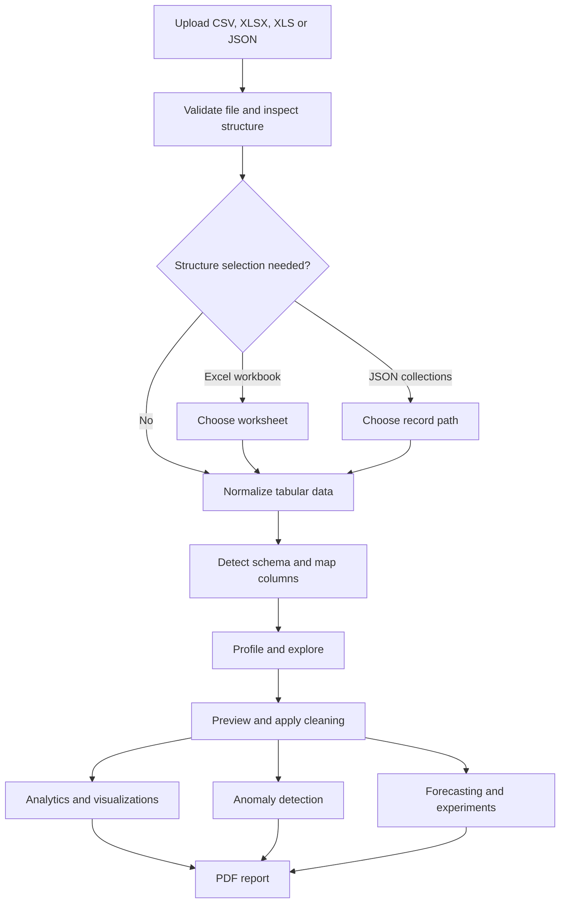

# InsightLab

<p align="center">
  <strong>Explore. Analyse. Predict.</strong><br />
  A unified workspace for structured data analytics, forecasting and research experimentation.
</p>

<p align="center">
  
  
  
  
  
</p>

<p align="center">
  <em>Transform data into meaningful insights.</em>
</p>

---

## Overview

**InsightLab** is a Django-based data analytics and predictive intelligence platform for working with structured, tabular datasets. Upload data, inspect its structure, prepare it for analysis, explore patterns, visualize variables, identify statistical anomalies, run time-series forecasts and export results as PDF reports—all from one workspace.

InsightLab is designed to work beyond a single business domain. It can process datasets such as sales, website traffic, expenses, inventory, employee records and other structured operational data, provided the data is represented in a supported tabular format.

The application also serves as the experimental platform for an MSc IT research project:

> **An Experimental Study of Machine Learning and Statistical Techniques for Sales Forecasting and Business Decision Support.**

The software is broader than the academic research focus: **InsightLab is the platform; comparative sales forecasting is the primary research study conducted with it.**

## What you can do with InsightLab

| Workspace | What it provides |
|---|---|
| **Dataset Management** | Upload CSV, Excel or JSON files, inspect datasets, map columns and manage original and processed versions. |
| **Data Explorer** | Search and preview records, inspect column names and understand detected data types. |
| **Data Cleaning** | Preview cleaning operations, handle missing values, remove duplicates and create a separate cleaned dataset. |
| **Exploratory Analysis** | Review descriptive statistics, distributions, correlations, time-based trends and category breakdowns. |
| **Visualization Studio** | Build line, bar, histogram and scatter charts using selected dataset columns. |
| **Anomaly Detection** | Identify unusual observations using statistical Z-score approaches. |
| **Forecasting** | Compare five statistical and machine-learning forecasting approaches on suitable time-series data. |
| **Experiment Lab** | Run six repeatable research experiment protocols for forecasting evaluation. |
| **PDF Reports** | Generate downloadable reports with dataset summaries, analysis, charts and available experiment results. |

## Supported file formats

InsightLab converts supported uploads into a common internal tabular representation so that the same downstream profiling, cleaning and analytics workflows can be used across file formats. The original uploaded file is retained separately.

| Format | Extension | Import behaviour |
|---|---|---|
| CSV | `.csv` | Reads tabular text, with UTF-8-SIG and Latin-1 decoding support. |
| Excel | `.xlsx` | Uses `openpyxl`. A single usable worksheet can be selected automatically; workbooks with multiple usable worksheets provide a worksheet-selection step and preview. |
| Legacy Excel | `.xls` | Uses `xlrd` and supports worksheet selection for multi-sheet workbooks. Excel serial dates are converted during import. |
| JSON | `.json` | Supports arrays of records, common wrapper keys, a single object as one record, nested objects and selection among candidate record collections. |

### Import limits and format notes

- Maximum upload size: **15 MB per file**.
- A usable tabular dataset must contain at least **two columns and one data row**.
- Excel worksheets are limited to **200,000 non-empty rows and 250 columns**. Oversized worksheets are rejected rather than silently truncated.
- `.xlsx` archives are also checked for archive-entry and uncompressed-size limits to reduce ZIP-bomb risk.
- Excel formulas are not executed. For `.xlsx`, cached formula values are read when available; formula cells without cached values may be imported as missing and noted.
- Encrypted or password-protected workbooks and macro-enabled `.xlsm` files are not supported.
- JSON collection discovery is limited to **25 candidate collections** and a maximum nesting depth of **12**. The interface reports when the candidate limit is exceeded.
- Nested JSON objects are flattened into columns. Nested arrays are retained as JSON text rather than expanded into additional rows.
- `.jsonl`, Parquet, XML and other formats are not currently supported.

## How the workflow fits together



## Analytics and data preparation

### Schema detection and profiling

InsightLab detects common column types:

- **Datetime** — date and time values.
- **Numeric** — measurable or quantitative values.
- **Categorical** — groups, labels and classes.
- **Text** — descriptive or free-form text.
- **Identifier** — record IDs and similar fields.

Users can map relevant columns, including an optional date/time column, a category/group column and numerical target/secondary columns. Profiling summarizes dataset size, missing values, duplicates, numerical statistics and other available quality indicators.

### Data cleaning

Cleaning is designed as a **preview-before-apply** workflow. Available operations include:

- Removing duplicate records.
- Handling invalid dates when a date column is mapped.
- Handling missing numerical values by dropping rows, or using median, mean or zero imputation.
- Handling missing categorical values by filling with `Unknown`, dropping rows or retaining blanks.
- Optional removal of rows containing negative values in numerical columns.
- Optional aggregation by mapped date and category.

The original uploaded file is preserved; cleaning creates a separate processed version.

> **Data-quality note:** Negative values can be valid (for example, refunds, losses, temperature readings or adjustments). The negative-value option affects numerical columns generally, so use it only when it is appropriate for the meaning of your data. Aggregation also changes the level of detail and should be selected deliberately.

### Exploratory data analysis

Depending on the available columns and the amount of data, InsightLab can provide:

- Descriptive statistics for numerical columns.
- Categorical and segment summaries.
- Pearson correlation summaries between numerical variables.
- Distribution histograms.
- Daily, weekly, monthly and yearly trends when a date column is mapped.
- Day-of-week patterns.
- Seven-day seasonal decomposition when there is sufficient daily history.

Analysis is data-dependent. A dataset without a date column can still be explored using its numerical and categorical fields; date-based analysis is simply unavailable for that dataset.

### Visualization Studio

Create interactive Chart.js visualizations using selected columns:

- Line charts.
- Bar charts.
- Distribution histograms.
- Two-variable scatter plots.

Available chart configurations depend on the selected columns and data types.

### Anomaly detection

InsightLab includes statistical anomaly detection for:

- **Time-series observations**, using a rolling historical baseline where suitable.
- **Cross-sectional records**, using Z-score deviations across numerical observations.

An anomaly is a statistical flag for investigation, not proof of an error or its underlying cause.

## Forecasting and model evaluation

Forecasting is intended for datasets with a suitable **date/time column** and a **numerical target column**. It is not applicable to every dataset—for example, a table of employee attributes without dates can still be explored, but it cannot be used directly for time-series forecasting.

### Implemented models

| Model | Approach |
|---|---|
| **Naive Forecast** | Uses the last observed training value as the baseline prediction. |
| **Moving Average** | Recursively forecasts using a trailing moving average. |
| **Linear Regression** | Uses lag-based and calendar features for recursive multi-step prediction. |
| **Random Forest Regressor** | Uses a tree-based regression model with lag-based and calendar features. |
| **ARIMA** | Uses Statsmodels ARIMA with fallback handling for short, constant or difficult-to-fit series. |

### Preprocessing and evaluation

- Historical observations are ordered chronologically.
- Train/test evaluation uses a chronological split rather than random shuffling.
- Missing time periods can be handled using the selected method: zero fill, forward fill or interpolation.
- Linear Regression and Random Forest use lag and calendar features, with recursive multi-step prediction.
- Models are evaluated on held-out observations using:
  - **MAE** — Mean Absolute Error.
  - **RMSE** — Root Mean Squared Error.
  - **MAPE** — Mean Absolute Percentage Error, calculated over non-zero actual values with an explanatory note.
  - **R²** — Coefficient of Determination when the test data supports its calculation.

The current forecasting implementation clips forecasts to non-negative values. This is suitable for many demand, quantity and revenue use cases, but it is a limitation for targets where negative predictions are meaningful (for example, temperature, net change or profit/loss). Review the target and model assumptions before interpreting results. Forecast quality also depends on data volume, frequency, missingness and the behaviour of the underlying series.

## Research Experiment Lab

The Experiment Lab supports six controlled experiment protocols aligned with the project's sales-forecasting research focus:

1. **Algorithm comparison** — compares the five forecasting models on the same chronological evaluation split.
2. **Dataset size** — compares trailing 25%, 50%, 75% and 100% training-history windows against a common test window.
3. **Seasonality features** — compares lag-only features with lag-plus-calendar features for Linear Regression and Random Forest.
4. **Missing data** — evaluates seeded missing-data levels (0%, 10%, 20% and 30%) with selected filling strategies, using an uncorrupted test segment.
5. **Volatility** — examines coefficient of variation and anomaly counts alongside forecasting errors.
6. **Segment/product comparison** — evaluates forecasting performance independently across available groups or products.

Experiment outputs are stored with their configuration and results to support review and reproducibility. These are empirical comparisons; the current application does not perform formal statistical significance tests such as Diebold–Mariano or Wilcoxon tests.

## Interface

InsightLab includes a responsive workspace interface with:

- A persistent, collapsible sidebar on larger screens.
- A mobile navigation drawer.
- **System**, **Light** and **Dark** appearance modes.
- System-theme detection on first visit and a saved manual preference.
- Theme-aware Chart.js defaults and existing chart instances.
- Reduced-motion support for users who prefer less animation.

## Technology stack

| Layer | Technology |
|---|---|
| Language | Python 3.15 (version recorded for the current project environment) |
| Web framework | Django 6.1.3 |
| Database | SQLite via Django ORM |
| Data processing | Pandas 3.1.1, NumPy 2.5.5, SciPy 1.18.1 |
| Machine learning | Scikit-learn 1.9.1, Statsmodels 0.15.0 |
| Excel ingestion | openpyxl 3.1.5 (`.xlsx`), xlrd 2.0.2 (`.xls`) |
| Frontend | Django Templates, HTML, Tailwind CSS 4.3.5, vanilla JavaScript |
| Charts | Chart.js 4.4.7 (bundled locally) |
| PDF/report generation | ReportLab 5.1.1, Matplotlib 3.11.2 |

Pinned Python dependencies are listed in [`requirements.txt`](requirements.txt). Tailwind's compiled stylesheet and the Chart.js browser bundle are included in the repository, so the application does not rely on a runtime CDN for those assets.

## Project structure

```text
InsightLab/
├── manage.py
├── requirements.txt
├── .env.example
├── .gitignore
├── README.md
├── PROJECT_PROGRESS.md
├── config/                  # Django settings and root URL/WSGI/ASGI configuration
├── accounts/                # Registration, login, profile and password management
├── datasets/                # Upload, format parsing, schema mapping, profiling and cleaning
├── analytics/               # Dashboard, EDA, visualizations, anomaly detection and insights
├── forecasting/             # Time-series preprocessing, models, metrics and research experiments
├── reports/                 # PDF report generation, download and deletion
├── templates/               # Django HTML templates
└── static/
    ├── css/                 # Compiled Tailwind stylesheet
    ├── js/                  # Application JavaScript and local Chart.js bundle
    ├── src/                 # Tailwind source stylesheet
    └── images/
```

## Getting started

### Prerequisites

- Python compatible with the pinned dependencies in `requirements.txt` (the current project environment records Python 3.15).
- `pip`.
- Git, if cloning the repository.

### 1. Get the project

```bash
git clone https://github.com/<your-username>/<your-repository>.git
cd InsightLab
```

Replace the repository URL and folder name with the values you use on GitHub.

### 2. Create and activate a virtual environment

**Windows PowerShell**

```powershell
python -m venv .venv
.\.venv\Scripts\Activate.ps1
```

**macOS / Linux**

```bash
python3 -m venv .venv
source .venv/bin/activate
```

### 3. Install dependencies

```bash
python -m pip install --upgrade pip
python -m pip install -r requirements.txt
```

### 4. Configure environment variables

The settings module reads values from the **process environment**. It does **not** automatically load a `.env` file. Use `.env.example` as a reference for the supported variables.

For local development, `DJANGO_DEBUG` defaults to `True`. If `DJANGO_SECRET_KEY` is not supplied in debug mode, InsightLab generates a local `.dev_secret_key` file, which is excluded by `.gitignore`.

**Windows PowerShell**

```powershell
$env:DJANGO_DEBUG = "True"
$env:DJANGO_ALLOWED_HOSTS = "localhost,127.0.0.1"
```

**macOS / Linux**

```bash
export DJANGO_DEBUG=True
export DJANGO_ALLOWED_HOSTS=localhost,127.0.0.1
```

For a non-debug environment, set a strong secret key and the correct hostnames before starting Django:

**Windows PowerShell**

```powershell
$env:DJANGO_DEBUG = "False"
$env:DJANGO_SECRET_KEY = "replace-with-a-long-random-secret"
$env:DJANGO_ALLOWED_HOSTS = "your-domain.example"
```

**macOS / Linux**

```bash
export DJANGO_DEBUG=False
export DJANGO_SECRET_KEY="replace-with-a-long-random-secret"
export DJANGO_ALLOWED_HOSTS="your-domain.example"
```

Never commit a real secret key. SQLite is the only database configured by the current settings; PostgreSQL configuration and production deployment hardening are future work.

### 5. Apply database migrations

```bash
python manage.py migrate
```

### 6. (Optional) Create an administrator account

```bash
python manage.py createsuperuser
```

### 7. Start the development server

```bash
python manage.py runserver
```

Open [http://127.0.0.1:8000/](http://127.0.0.1:8000/) in your browser.

## Running tests and checks

Run the Django test suite:

```bash
python manage.py test -v 2
```

Run Django's project checks:

```bash
python manage.py check
```

Check whether model changes require new migrations:

```bash
python manage.py makemigrations --check --dry-run
```

Run these commands from the project root with the virtual environment activated. Test results can vary with code and dependency changes; consult the current project run rather than relying on a historic test count.

## Application areas

| Area | Route |
|---|---|
| Dashboard | `/` |
| Login / Registration | `/accounts/login/` · `/accounts/register/` |
| Account settings | `/accounts/settings/` |
| Datasets | `/datasets/` |
| Upload dataset | `/datasets/upload/` |
| Data Explorer | `/datasets/explorer/` |
| Data Cleaning | `/datasets/cleaning/` |
| Data Analysis | `/analytics/` |
| Visualization Studio | `/analytics/visualizations/` |
| Anomaly Detection | `/analytics/anomalies/` |
| Forecasting | `/forecasting/` |
| Model Comparison | `/forecasting/compare/` |
| Experiment Lab | `/forecasting/experiments/` |
| Reports | `/reports/` |
| Django Admin | `/admin/` |

Dataset-specific pages (details, column mapping, Excel worksheet selection and JSON record-path selection) are linked from the dataset workflow.

## Sample data

The application provides synthetic sample CSV downloads for exploring the workflows:

- **Sales:** `/datasets/sample-csv/?type=sales`
- **Website traffic:** `/datasets/sample-csv/?type=traffic`
- **Business expenses:** `/datasets/sample-csv/?type=expenses`

These are synthetic examples, not real business records or research findings.

## Security and data handling notes

- Account access is protected by Django authentication and password validation.
- Dataset and report views apply per-user ownership checks.
- Logout and destructive actions use POST requests; forms use Django CSRF protection.
- Upload validation checks supported formats and file content, not just the filename extension.
- Excel macro execution is not supported; workbook formulas are not evaluated by the application.
- Original uploads, normalized files, cleaned files and generated reports are stored under local media storage during development.
- The local SQLite database, media uploads, generated artifacts, secrets and virtual environments are excluded through `.gitignore`.

**Deployment caution:** The included configuration is for local development and project evaluation. Before deploying publicly, configure a production secret key, `DEBUG=False`, allowed hosts, HTTPS/security settings, production static/media storage, backups and a production-grade database. Do not expose the development media server as a production file server.

## Known limitations

- The platform is designed for structured tabular data; it is not an image, audio, PDF-document or free-form text analytics platform.
- Only `.csv`, `.xlsx`, `.xls` and `.json` uploads are supported currently. `.xlsm`, `.jsonl`, Parquet, XML and direct database/API connectors are not implemented.
- Uploads are limited to 15 MB. Excel worksheets are limited to 200,000 non-empty rows and 250 columns; `.xlsx` archive safeguards also apply.
- Encrypted/password-protected Excel workbooks are unsupported. `.xlsx` formula cells without cached values may be treated as missing.
- JSON discovery has a 25-candidate limit and a maximum nesting depth of 12.
- Time-series forecasting requires a mapped date/time column and numerical target, with sufficient chronological observations for a meaningful split.
- Forecasts are clipped to non-negative values in the current model implementation; this is not appropriate for every possible target variable.
- SQLite is the only configured database engine. Production PostgreSQL settings are not included yet.
- Formal statistical significance testing across models or datasets is not currently implemented.

## Future directions

Potential extensions include:

- JSON Lines and Parquet ingestion.
- Direct database and API data sources.
- Additional forecasting approaches, such as gradient boosting and SARIMAX with exogenous variables.
- Formal statistical comparison tests across benchmark datasets.
- Production database and deployment configuration.

## Academic context

InsightLab is being developed alongside an MSc IT research project focused on evaluating statistical and machine-learning methods for sales forecasting and business decision support. The application provides the data preparation, modelling, experiment and reporting environment; the dissertation should document the literature review, research design, data sources, controlled experiments, observations, results and interpretation.

Research findings and model-performance claims should be based on experiments actually conducted and should not be inferred from the presence of a feature in the application.

## License

No open-source license has been added to this repository yet. Until a license is selected and included, reuse and redistribution are not granted by this README.

---

<p align="center">
  <strong>InsightLab</strong><br />
  <em>Explore. Analyse. Predict.</em>
</p>
